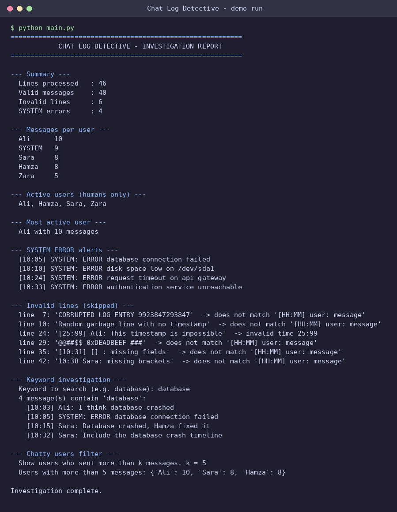
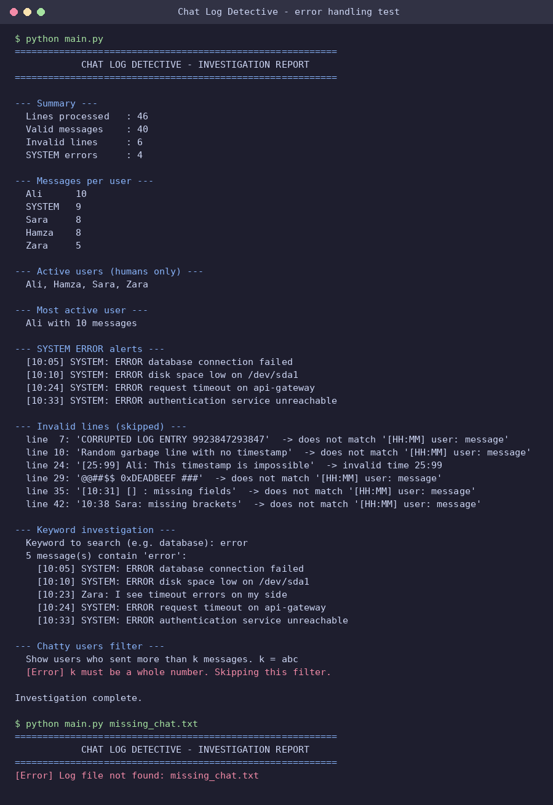

# Chat Log Detective

**Week 2: Advanced Python & Data Structures**
**IEEE LGU AI/ML Cohort One**
**AI/ML Leads:** Abdullah Faisal & Alina Irshad

**Author:** Zainab Saeed, BS Computer Science, Lahore Garrison University
**GitHub:** [zainabdev01](https://github.com/zainabdev01)

---

## 1. Project Overview

Chat Log Detective is a forensic log analyzer. It parses a raw server and chat log that contains normal conversation, SYSTEM alerts and corrupted lines, then prints an investigation report with message counts, active users, errors and keyword matches.

## 2. Concepts Implemented

- **Object-Oriented Programming:** `Message` (timestamp, sender, content, `is_system_error`, a `from_line()` class method for parsing) and `ChatLog` (stores messages and runs every analysis).
- **File Handling:** The log is read line by line from `data/chat.txt`. A regular expression validates the `[HH:MM] user: message` structure.
- **Error & Exception Handling:** Each line is parsed inside `try/except`. Lines with the wrong structure or an impossible time (for example `25:99`) are recorded as invalid lines with the reason, and parsing continues. A missing file is reported, the file is closed in `finally`, and the keyword/threshold prompts reject non-numeric input.
- **Data Structures:** A dictionary `{username: count}`, a `set` of active human users, a list of invalid lines and a nested dictionary `{user: {hour: count}}` for activity by hour.
- **List / Dictionary Comprehension:** `{u: c for u, c in counts.items() if u != "SYSTEM" and c > k}` finds users who sent more than *k* messages. List comprehensions are used for keyword search and error isolation.

## 3. Project Structure

```
ieee-chat-log-detective/
├── README.md
├── main.py              # Console application
├── models.py            # Message and ChatLog classes
├── data/
│   └── chat.txt
└── screenshots/
    ├── demo_run.png
    └── error_handling_test.png
```

## 4. How to Run the Program

Requires Python 3.8 or newer. No external libraries are needed.

```bash
git clone https://github.com/zainabdev01/ieee-chat-log-detective.git
cd ieee-chat-log-detective
python main.py
```

Pass a different log if needed: `python main.py path/to/chat.txt`

The program prints the full report, then asks for a keyword to investigate and a message threshold *k*.

## 5. Dataset Information

`data/chat.txt` contains **46 lines**: **40 valid messages** (human messages plus SYSTEM INFO, WARNING and ERROR alerts) and **6 corrupted lines**:

| Line | Content | Problem |
|------|---------|---------|
| 7 | `CORRUPTED LOG ENTRY 9923847293847` | No timestamp or sender |
| 10 | `Random garbage line with no timestamp` | No timestamp |
| 24 | `[25:99] Ali: ...` | Impossible time |
| 29 | `@@##$$ 0xDEADBEEF ###` | Garbage characters |
| 35 | `[10:31] [] : missing fields` | Missing sender |
| 42 | `10:38 Sara: ...` | Missing brackets around time |

The log has 4 SYSTEM ERROR alerts.

## 6. Execution Screenshots & Proof

### Demo run
Full investigation report: summary, messages per user, active users, most active user, SYSTEM errors, skipped invalid lines, keyword search for `database` and the chatty-user filter.



### Error handling test
Non-numeric threshold input is handled gracefully, and starting the tool with a missing log file prints a clear error instead of crashing.


